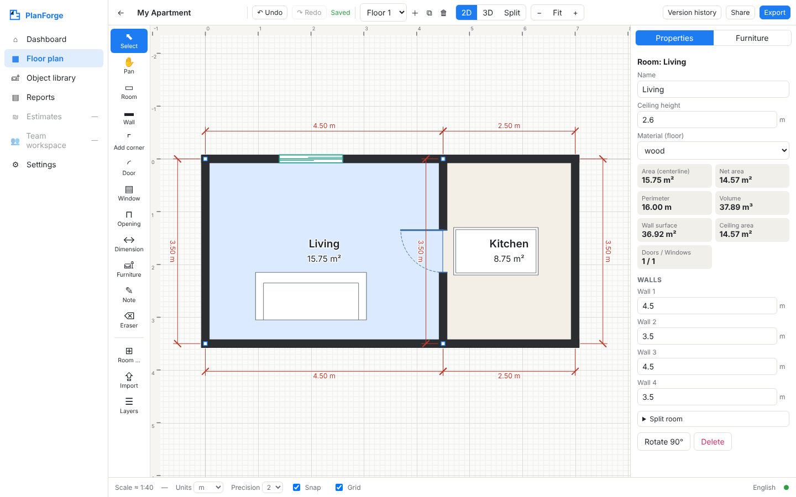

# PlanForge Studio

Floor-plan creation and property documentation as an installable web app (PWA): a CAD-style 2D editor,
real-time 3D generated from the same model, exact dimensioning, to-scale PDF/DXF/SVG and 3D exports,
offline IndexedDB persistence with undo/redo and version snapshots, and Hebrew RTL / English LTR UIs.

**Status:** the first end-to-end vertical slice. *Create project → draw room → edit dimensions → add door
→ 3D → save → reload → export PDF* works and is covered by automated tests. See
[IMPLEMENTATION_STATUS.md](IMPLEMENTATION_STATUS.md) for the full feature matrix, including what is **not** built yet
(server, accounts, sync, costing, native scanning).



## Quick start

```bash
npm install          # Node >= 20
npm run build        # bundles apps/web -> apps/web/dist (esbuild)
npm start            # http://localhost:4173
```

| Script | What it does |
|---|---|
| `npm test` | Geometry + export unit tests (`node:test` via `tsx`), 27 tests |
| `npm run test:e2e` | Playwright end-to-end tests against the built app, 4 tests incl. the primary acceptance flow |
| `npm run typecheck` | Strict TypeScript for packages and app |
| `npm run verify` | All of the above, in order |
| `node --import tsx scripts/export-examples.ts` | Regenerates `docs/export-examples/` (demo data, clearly labelled) |

Playwright needs a Chromium: `npx playwright install chromium`, or set `CHROME_PATH` to an existing Chrome binary.

## Live site (GitHub Pages)

https://orlev819-dev.github.io/planforge-studio/ is served over HTTPS, so Web Bluetooth works there, including in the Bluefy browser on iOS.
Deploy: `bash scripts/deploy-pages.sh` builds the app and force-pushes the static site to `orlev819-dev/planforge-studio` (`main`, root). Pages rebuilds within about two minutes.
The repository holds only the built site. Source lives in this monorepo.

Local network server (Windows, no install needed): `server/start-server.bat`, which runs a PowerShell static server on port 8080.

## Using the editor

- **Rooms:** `R` then drag a rectangle, or click corners and double-click / `Enter` to close a polygon. While drawing, type a length (e.g. `3.6`, `360cm`, `12' 6"`) and press `Enter` to place the next corner exactly. The **Room…** button creates rooms with exact width/length/height, optionally attached to the selected room, which gives you shared walls.
- **Edit dimensions:** select a room and type wall lengths in the Properties panel. Rectangles stay rectangular, and a shared wall moves both rooms. You can also drag corners, walls, rooms, furniture, doors and windows. Every edit is validated: a self-intersecting or overlapping room, or a door that no longer fits its wall, is refused with a message, and the model is never left corrupted.
- **Lowered ceilings:** tool `C` (⬓), drag a rectangle where the ceiling is lower, then set its height in Properties. It shows hatched in 2D/PDF/DXF, as a block in 3D, and reduces the room volume.
- **Your own models:** Furniture tab → My models → ⇪ OBJ / STL. Check the detected size (file units, up axis), then click the plan to place it. Models are saved inside the project.
- **Openings:** pick Door (`D`), Window (`N`) or Opening, then click a wall. Type, size, sill, offset, hinge and swing are edited in Properties.
- **Furniture:** open the Furniture tab, then click an item and click the plan, or drag it onto the plan. Use the handles to rotate and resize, `R` to rotate 90°, and the arrow keys to nudge 1 cm (10 cm with Shift).
- **Other keys:** `Ctrl+Z` / `Ctrl+Shift+Z` (or `Ctrl+Y`), `Ctrl+C` / `Ctrl+V` / `Ctrl+D`, `Delete`, `Esc`, `F` (fit), `G` (grid), `S` (snap), `Space`+drag or middle mouse to pan, mouse wheel or pinch to zoom, right-click for the context menu, `Alt` to suspend snapping.
- **3D:** 2D / 3D / Split. Orbit (drag), pan (right-drag), zoom (wheel or pinch), Top / Isometric / Perspective views, Walk (WASD plus drag to look), solid / transparent / hidden walls, roof, and all floors.
- **Bluetooth laser (Bosch GLM 50-27 C/CG, Chrome/Edge):** 📏 in the top bar → Connect. Each measurement goes into the focused length field, the wall/room you are drawing (toward the cursor), or the selected wall's length.
- **Import a plan:** Import loads a PDF (any page), PNG, JPG or SVG as a reference layer. Calibrate it by clicking two points and typing their real distance, then trace over it. The reference stays an image and is never treated as CAD geometry.

## Repository layout

```
apps/web               React PWA (dashboard, editor, 3D view, dialogs, IndexedDB, i18n)
apps/api               NOT STARTED: server (see README inside)
apps/mobile            NOT STARTED: native iOS/Android shells (see README inside)
packages/shared-types  Document model types + furniture catalog
packages/geometry      Geometry kernel: validated commands, measurements, units, schema
packages/cad-io        Drawing list + PDF/SVG/DXF/GLB/OBJ/CSV/JSON writers, DXF/GLB readers
packages/renderer-3d   Renderer-independent mesh builder + WebGL viewer
packages/scanning      Capture/BLE interfaces + honest capability detection (no drivers yet)
tests/e2e              Playwright specs
docs/                  Screenshots + export examples (demo data)
```

## Deviations from the suggested stack (and why)

The build environment had **no network access**, so only packages already on the machine could be used.
Each substitution sits behind a module boundary so the intended library can be swapped in later:

| Suggested | Used | Note |
|---|---|---|
| Three.js / R3F | Own WebGL renderer (`packages/renderer-3d/src/webgl.ts`) | Mesh generation is renderer-independent (`mesh.ts`), so a Three.js viewer can consume the same `MeshPart[]`. |
| Vite | esbuild (`scripts/build.mjs`) | Same ESM output. Vite can be dropped in for dev HMR. |
| Vitest | `node:test` + `tsx` | Same assertions style. |
| Zustand / TanStack Query | Small `useSyncExternalStore` store | API-compatible concept: selectors and actions. |
| Tailwind | Plain CSS variables (light/dark) with logical properties for RTL | |
| Konva | Canvas 2D with own hit-testing/snapping | |
| fontkit (Hebrew in PDF) | Browser canvas rasterizes non-Latin PDF text | Hebrew is shaped correctly but is not selectable text in the PDF. |
